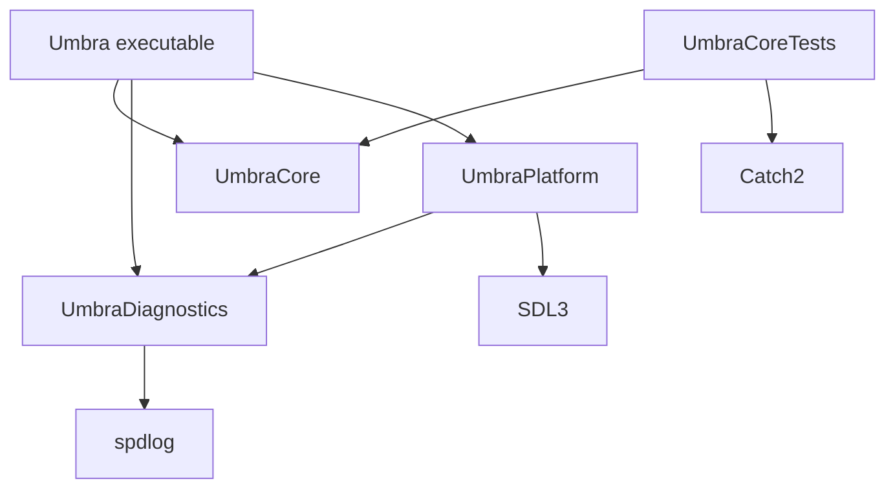
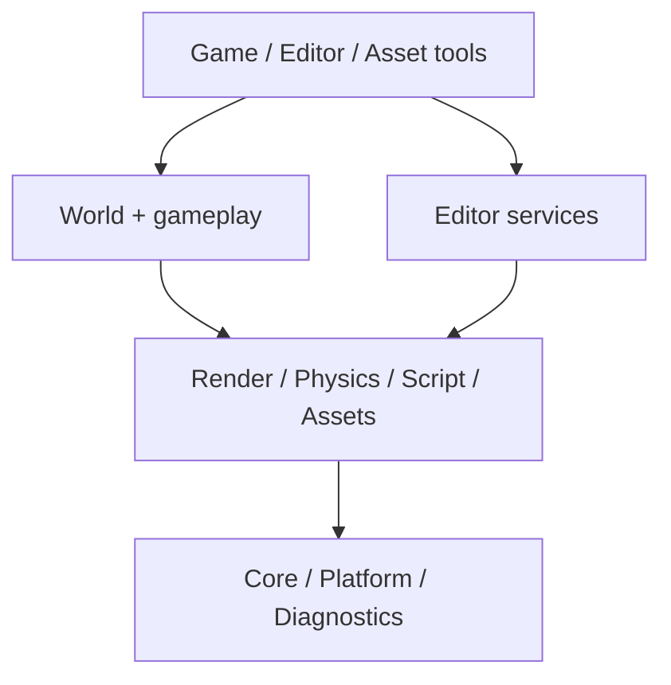
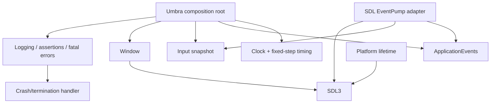

# Custom 3D Game Engine: Learning-First Roadmap

## Project brief

Build a small, modular 3D engine whose first real deliverable is a complete small game. The engine should teach the fundamentals—loop, rendering, lighting, scripting, memory, tooling, physics, and debugging—while creating room to experiment with faster C# iteration, explicit memory budgets, and improved physics workflows.

The initial platform pair should be **Windows x64 + Android ARM64**. Keep the architecture portable from the beginning, but add Linux, macOS, and iOS only after the first game works. Supporting every desktop and mobile platform simultaneously would turn the first milestone into a porting project instead of an engine-learning project.

## Recommended direction

- **Engine/runtime:** C++20
- **Gameplay scripting:** C# on desktop, hosted through .NET
- **Mobile scripting:** precompiled/AOT C# for shipping; data and asset hot reload everywhere
- **First renderer:** Vulkan, initially on Windows and then Android
- **Physics:** Jolt Physics behind an engine-owned interface
- **Editor:** Dear ImGui docking branch
- **Build:** CMake with manifest-mode vcpkg
- **Architecture:** modular runtime, separate editor executable, stable handles rather than raw pointers across module/script boundaries
- **Development philosophy:** single-threaded correctness first; measure with profiling; introduce jobs, pools, and specialized allocators only where evidence supports them

This gives you low-level access where learning and optimization matter, while avoiding spending years rebuilding windowing, font rasterization, image decoding, and production collision detection before a game exists.

## Current implementation status (2026-08-16)

Umbra has completed its first **Windows x64 bootstrap smoke test**. The toolchain, dependency restoration, modular CMake target graph, SDL3 window, logging wrapper, and first automated test are working. This is a verified subset of Phase 1 rather than completion of the full Foundation phase.

### Confirmed project decisions

| Area | Current decision |
|---|---|
| Development host | Windows 11 x64 |
| Primary IDE | Visual Studio Community 2026, opening the repository directly as a CMake folder project |
| Language | C++20 |
| Primary Windows compiler | MSVC 19.51.36256, native x64 host and target |
| Verification compiler | Clang/clang-cl 22.1.3, x64 |
| Build tools | CMake 4.3.1-msvc1 + Ninja 1.13.2, using `Ninja Multi-Config` |
| Dependency management | vcpkg manifest mode, `x64-windows`, pinned registry baseline |
| First desktop target | Windows x64 |
| First mobile target | Android `arm64-v8a`, minimum API 28; not yet configured |
| Graphics direction | Vulkan on Windows first, Android afterward |

`CMakePresets.json` currently provides shared MSVC and Clang configure presets, MSVC Debug/Release build presets, a Clang Debug build preset, and an MSVC Debug test preset. The Windows preset declares `architecture.value = "x64"` with `strategy = "external"`, allowing Visual Studio to prepare the native x64 environment while command-line builds continue to use an x64 Developer shell.

### Verified dependency baseline

| Package | Resolved version | Current use |
|---|---:|---|
| Catch2 | 3.15.3 | Active in `UmbraCoreTests` |
| fmt | 12.2.0#1 | Transitive dependency of spdlog |
| GLM | 1.0.3 | Installed; deliberately deferred until math/render work needs it |
| SDL3 | 3.4.14 with `core` and `vulkan` | Active in `UmbraPlatform` |
| spdlog | 1.17.0#1 with `core`, `tz-offset`, and `fmt` | Active behind the Umbra Diagnostics API |
| Volk | 1.4.357.0 | Installed; deferred to the Render/RHI module |
| Vulkan Headers | 1.4.357.0 | Installed transitively; deferred to Render/RHI |
| Vulkan Memory Allocator | 3.4.0 | Installed; deferred until Vulkan device/resource allocation exists |

The Vulkan SDK and RenderDoc are installed separately from vcpkg. `vkcube.exe` displays correctly, proving that the Windows Vulkan loader, GPU driver, and presentation path work. A saved RenderDoc capture has not yet been recorded as a project checkpoint.

### Active repository architecture

```text
/apps/umbra                 current Umbra desktop executable and composition root
/engine/core                foundational module; currently exposes the engine version
/engine/diagnostics         engine-owned logging API backed privately by spdlog
/engine/platform            SDL3 initialization, Vulkan-capable window, and close/Escape events
/tests/core                 Catch2/CTest coverage for Core
/engine/assets              reserved; not yet part of the CMake target graph
/engine/editor              reserved; not yet part of the CMake target graph
/engine/physics             reserved; not yet part of the CMake target graph
/engine/render              reserved; not yet part of the CMake target graph
/engine/script              reserved; not yet part of the CMake target graph
/engine/world               reserved; not yet part of the CMake target graph
/samples                    reserved for focused executable samples
/tools                      reserved for offline/headless tools
```

Only directories reached by `add_subdirectory(...)` participate in configuration or compilation. The reserved folders do not yet define runtime behavior merely because they exist.

Current CMake targets and dependency direction:



- `UmbraCore` is a static library with the stable alias `Umbra::Core`. `Version.hpp/.cpp` currently return `0.1.0`.
- `UmbraDiagnostics` is a static library with the alias `Umbra::Diagnostics`. Its public API exposes initialization, info/error logging, and shutdown without exposing spdlog types.
- `UmbraPlatform` is a static library with the alias `Umbra::Platform`. It privately uses SDL3 and Diagnostics. Its `Window` owns an `SDL_Window`, prevents copying, destroys the window through RAII, and recognizes window-close and Escape events.
- `Umbra` is the executable composition root. It initializes Diagnostics and Platform, creates a resizable `SDL_WINDOW_VULKAN` window, polls events, sleeps briefly to avoid unrestricted busy-spinning, and shuts down in reverse ownership order.
- `UmbraCoreTests` links `Umbra::Core` with `Catch2::Catch2WithMain` and is registered in CTest as `Umbra.Core`.

The `SDL_WINDOW_VULKAN` flag only makes the window eligible for later Vulkan surface creation. Umbra does not yet create a Vulkan instance, device, surface, swapchain, command buffer, or rendered frame.

### Verified bootstrap evidence

The following sequence succeeds from the native x64 developer environment:

```powershell
cmake --fresh --preset windows-msvc
cmake --build --preset windows-msvc-debug
ctest --preset windows-msvc-debug
& ".\out\build\windows-msvc\apps\umbra\Debug\Umbra.exe"
```

Verified results:

- CMake selects `Hostx64/x64/cl.exe`, restores the manifest dependencies, and generates Ninja build files.
- The MSVC Debug build completes and links `Umbra.exe`.
- CTest runs `Umbra.Core`: 1/1 tests pass.
- The executable logs Diagnostics initialization, Umbra `0.1.0`, Platform initialization, window creation, window destruction, Platform shutdown, and Diagnostics shutdown in the expected order.
- The window opens, remains responsive, and closes through Escape or the native close action.

CMake's failed probes for `pthread_create` are expected on Windows; `Found Threads: TRUE` confirms that CMake selected the supported Windows threading implementation.

### Foundation work still required

Before declaring Phase 1 complete, Umbra still needs:

- an engine-owned monotonic clock and clamped frame delta;
- a fixed-timestep accumulator with a deterministic unit test;
- an input snapshot with explicit pressed/held/released semantics instead of handling only close/Escape directly;
- resize, focus, suspend/resume, and quit lifecycle events with deterministic ownership;
- a defined failure/assertion path and basic crash information;
- MSVC and Clang warning policies plus an AddressSanitizer configuration;
- continuous integration that configures, builds, and tests a clean checkout;
- at least one RenderDoc capture once Umbra itself submits Vulkan work.

The immediate next implementation slice is therefore **the remainder of Phase 1: Clock + fixed engine loop + input/lifecycle contracts**. After those exit tests pass, Phase 2 begins with Vulkan validation, instance/device selection, SDL surface creation, swapchain lifecycle, and a captured triangle.

## How established engines are structured

Large engines are rarely designed completely and then implemented. They usually grow with one or more games: a platform layer and loop appear first, rendering and resource management follow, game-specific systems reveal reusable abstractions, and editors/pipelines are added to reduce iteration cost. Their mature architectures show three recurring ideas:

1. **A small core with strict dependency direction.** Godot documents a layered organization around core types, platform drivers, servers, and the scene layer. Its scripting languages and many features are modules rather than inseparable parts of the core. See [Godot's architecture documentation](https://docs.godotengine.org/en/stable/engine_details/architecture/index.html) and [custom C++ modules](https://docs.godotengine.org/en/stable/engine_details/engine_api/custom_modules_in_cpp.html).
2. **Feature modules instead of one monolith.** Unreal describes its engine as a collection of modules that games extend with their own modules. See [Unreal Engine Modules](https://dev.epicgames.com/documentation/en-us/unreal-engine/modules?application_version=4.27).
3. **Runtime/editor separation.** O3DE Gems can contain runtime and editor modules separately, with known module entry points and lifecycles. See the [O3DE Gem module system](https://docs.o3de.org/docs/user-guide/programming/gems/overview/) and [code Gem structure](https://docs.o3de.org/docs/user-guide/programming/gems/code-gems/).

Do not copy the scale of those engines. Copy their boundaries: a game should depend on public engine interfaces, editor code should not leak into the shipping runtime, and third-party systems should sit behind adapters.

## Target architecture



Suggested repository layout:

```text
/engine/core          IDs, foundational types, math/time utilities, memory primitives
/engine/diagnostics   logging, assertions, crash reporting, profiling hooks
/engine/platform      window, input, filesystem, threads
/engine/render        RHI, renderer, materials, lighting
/engine/assets        import, build, cache, resource manager
/engine/world         entities, components, transforms, scenes
/engine/physics       public API + Jolt adapter
/engine/script        native ABI + .NET host
/engine/editor        editor services and panels
/apps/umbra           current runtime bootstrap; later the shipping game executable
/apps/editor          editor executable
/tools/assetc         headless asset compiler
/tests                unit, integration, replay tests
/samples              triangle, lighting, physics, scripting
```

Rules worth establishing immediately:

- Runtime modules never depend on editor modules.
- Gameplay never sees Vulkan, Jolt, or CLR objects directly.
- Cross-boundary references use generational handles such as `EntityId`, `ResourceHandle`, and `PhysicsBodyId`.
- Serialized data owns durable state; pointers and runtime handles are reconstructed.
- Every subsystem has explicit `Initialize`, `Tick` where applicable, and `Shutdown` ownership.
- Dependencies are declared and initialized topologically; avoid global construction order.

## The first engine loop

Begin with a single-threaded fixed-update loop. It makes behavior reproducible and creates a clean point for physics and script updates.

```cpp
while (platform.PumpEvents())
{
    const double frameTime = clock.SampleClampedDelta();
    accumulator += frameTime;

    input.BeginFrame();

    while (accumulator >= fixedDelta)
    {
        scripts.FixedUpdate(fixedDelta);
        physics.Step(fixedDelta);
        world.CommitDeferredChanges();
        accumulator -= fixedDelta;
    }

    const float alpha = float(accumulator / fixedDelta);
    renderer.Render(world.ExtractRenderScene(alpha));
    platform.Present();
}
```

Important lessons in this small loop include monotonic timing, delta clamping, fixed simulation, render interpolation, input edge semantics, deferred world mutation, suspend/resume, and deterministic shutdown. Add a render thread or general job graph only after the simple version has profiler evidence and tests.

## Foundation libraries

These are primitive building blocks, not an engine assembled from another engine.

| Area | Recommended dependency | Why | What you still implement |
|---|---|---|---|
| Build | CMake + vcpkg manifests | Works well with Visual Studio and Rider; pins dependencies | Targets, module graph, presets, CI |
| Platform | SDL3 | Windows, Linux, macOS, Android, and iOS support are documented by SDL | Engine event model, lifecycle, input mapping |
| Graphics API | Vulkan SDK + Volk | Explicit modern API across Windows/Linux/Android | RHI, resource lifetime, synchronization, passes |
| GPU memory | Vulkan Memory Allocator | Handles Vulkan heap/type selection and exposes budgets/statistics | Resource policy, streaming, lifetime tracking |
| Math | GLM initially | Header-only graphics math with GLSL-like conventions | Coordinate conventions, transform policy, tests |
| Editor GUI | Dear ImGui docking | Fast path to inspector, hierarchy, console, profiler panels | Editor data model, undo/redo, selection, persistence |
| Asset interchange | glTF 2.0 via fastgltf or cgltf | Focuses the first importer on one modern format | Import database, derived artifacts, dependency tracking |
| Mesh processing | meshoptimizer / `gltfpack` | Mesh cache/fetch optimization, quantization, simplification | Offline build policy and runtime format |
| Textures | KTX2 + Basis Universal | Portable GPU-compressed texture delivery, important on mobile | Quality tiers, transcoding choice, streaming |
| Physics | Jolt Physics | Modern C++, multithread-friendly rigid bodies and queries, MIT license | Stable engine API, gameplay semantics, debug UI |
| C# hosting | `nethost` + `hostfxr` | Official native .NET hosting path | ABI, object lifetime, bindings, exception policy |
| C# compiling | Roslyn | Compiler APIs can produce IL and diagnostics programmatically | Build orchestration, reload/migration protocol |
| Profiling | Tracy | CPU, GPU, allocation, lock, and frame profiling | Engine zones, counters, budgets, performance tests |
| Logging | spdlog behind an Umbra-owned Diagnostics API; fmt currently arrives transitively | Avoids rebuilding formatting and sinks without leaking third-party types | Categories, crash ring buffer, structured fields |
| Tests | Catch2 or GoogleTest | Mature unit-test runner | Deterministic fixtures, golden images, replay tests |

SDL documents its supported platforms in [SDL3 platform support](https://wiki.libsdl.org/SDL3/README-platforms). The official [Khronos Vulkan tutorial](https://docs.vulkan.org/tutorial/latest/00_Introduction.html) explicitly covers Windows, Linux, and Android and notes MoltenVK for Apple platforms. VMA provides allocation algorithms and heap budgets; see its [documentation](https://gpuopen-librariesandsdks.github.io/VulkanMemoryAllocator/html/) and [budget API](https://gpuopen-librariesandsdks.github.io/VulkanMemoryAllocator/html/statistics.html).

For mobile rendering, study—not initially embed—Google's Filament. It is a compact PBR renderer supporting Android, iOS, desktop, Vulkan, Metal, and OpenGL, and its [PBR design document](https://google.github.io/filament/Filament.md.html) explains practical lighting choices. The [Khronos Vulkan Samples](https://github.com/KhronosGroup/Vulkan-Samples) are valuable for mobile performance practices.

### Libraries deliberately deferred

- **EnTT:** useful as a benchmark/reference, but a full ECS is not required for the first scene. Start with generational entity IDs and sparse component storage; compare against EnTT after profiling. Its official repository documents its storage and scheduling facilities: [EnTT](https://github.com/skypjack/entt).
- **mimalloc:** test later as a drop-in baseline, not as proof that memory design is solved. Its project emphasizes a compact general allocator, but workload measurement still matters: [mimalloc](https://github.com/microsoft/mimalloc).
- **bgfx:** excellent if shipping quickly matters more than learning graphics APIs. It supports D3D, Metal, OpenGL, Vulkan, and WebGPU backends, but it hides much of the RHI work you explicitly want to learn: [bgfx](https://github.com/bkaradzic/bgfx).
- **Qt:** powerful for a polished desktop editor, but too heavy for the first editor. Move from ImGui to Qt only if native desktop workflows become a defining goal.

## Scripting and hot reload

### Recommended model

The engine owns the world in native C++. C# objects are behavioral façades identified by native handles. Scripts can request operations but cannot retain pointers into native storage.

Use a narrow, versioned interop API:

```text
EntityId + ComponentTypeId + POD values
commands from C# -> native command buffer
events/snapshots from native -> C#
```

The official [.NET native hosting tutorial](https://learn.microsoft.com/en-us/dotnet/core/tutorials/netcore-hosting) shows how a C++ process locates `hostfxr`, starts the runtime, loads an assembly, and obtains managed function pointers. Roslyn exposes compilation models and IL emission through the [.NET Compiler Platform SDK](https://learn.microsoft.com/en-us/dotnet/csharp/roslyn-sdk/) and [`Compilation.Emit`](https://learn.microsoft.com/en-us/dotnet/api/microsoft.codeanalysis.compilation.emit).

### Reload protocol

Implement full assembly replacement before attempting Edit-and-Continue deltas:

1. Pause script callbacks at a safe frame boundary.
2. Serialize script-visible fields into a neutral property bag keyed by stable entity, component, and field identifiers.
3. Remove subscriptions, delegates, tasks, and native callbacks owned by the old script domain.
4. Load the rebuilt assembly into a new collectible `AssemblyLoadContext`.
5. Validate the new type/schema map.
6. Recreate managed façades and migrate compatible state.
7. Atomically swap the active script world and unload the old context.
8. Verify unloading with a weak reference; report retained roots in the editor.
9. Resume scripts without recreating the native world, renderer, or physics scene.

`AssemblyLoadContext` is the .NET mechanism for isolated dynamic loading/unloading; see [Microsoft's overview](https://learn.microsoft.com/en-us/dotnet/core/dependency-loading/understanding-assemblyloadcontext). IDE Hot Reload supports only certain edits and configurations, so it should later become an optional fast path rather than the correctness path; see [Visual Studio Hot Reload limitations](https://learn.microsoft.com/en-us/visualstudio/debugger/hot-reload?view=visualstudio).

### Mobile limitation

Treat C# code hot reload as an editor/development feature, not a universal runtime promise. Native AOT does not permit loading and executing new assemblies at runtime and restricts dynamic code; Microsoft documents those constraints for [Native AOT on iOS](https://learn.microsoft.com/en-us/dotnet/maui/deployment/nativeaot?view=net-maui-10.0). Therefore:

- Desktop editor: full C# compile/reload.
- Android development: investigate JIT/interpreter support only after desktop reload is stable.
- iOS shipping: AOT-compiled scripts; no arbitrary new assembly loading.
- All platforms: hot-reload materials, textures, meshes, scenes, tuning data, localization, and prefabs.
- If live gameplay-code replacement on iOS is a hard requirement, add a deliberately small Lua layer. Lua provides a compact C API and incremental/generational GC modes; see the [Lua 5.4 manual](https://www.lua.org/manual/5.4/manual.html).

## Physics strategy

Do not make a production-quality 3D physics engine a prerequisite for the first game. It combines broad-phase acceleration structures, convex collision detection, persistent manifolds, contact solving, friction, stacking stability, sleeping, joints, CCD, character movement, multithreading, and debugging.

Use two parallel tracks:

### Production track

Define an engine-owned interface around bodies, shapes, queries, contacts, layers, and stepping. Implement it first with Jolt. Jolt describes itself as a multicore-friendly rigid-body and collision library and explicitly supports concurrent queries and background body preparation; see [Jolt's repository and design considerations](https://github.com/jrouwe/joltphysics) and [architecture guide](https://jrouwe.github.io/JoltPhysics/).

Keep the adapter narrow enough to compare alternatives:

- [Bullet](https://github.com/bulletphysics/bullet3): broad platform history and multi-physics/research use.
- [NVIDIA PhysX](https://github.com/NVIDIA-Omniverse/PhysX): mature real-time SDK under BSD-3-Clause.

### Learning/R&D track

Build a separate `PhysicsLab` executable in this order:

1. vectors, quaternions, transforms, AABBs, and integration;
2. sphere/box/plane collision;
3. broad phase using sweep-and-prune or a dynamic AABB tree;
4. SAT for boxes and GJK for convex shapes;
5. EPA/contact generation and persistent manifolds;
6. sequential-impulse solver with restitution and friction;
7. sleeping, islands, constraints, and warm starting;
8. continuous collision detection;
9. deterministic replay tests and multithread experiments.

Compare this lab against the Jolt-backed engine using identical recorded scenes. This makes physics optimization measurable without endangering the game milestone.

## Memory and performance policy

The first optimization feature should be **observability**, not a custom allocator.

Implement:

- allocation tags by subsystem and lifetime;
- current, peak, and per-frame bytes/allocation counts;
- CPU and GPU memory budgets;
- generational handles to detect stale access;
- frame arenas for transient render/extraction data;
- level/scene arenas where bulk teardown is natural;
- pool or slab allocation only for proven fixed-size hot objects;
- deferred GPU destruction tied to completed fences;
- zero-allocation assertions for selected steady-state paths;
- load tests and captured replays that make regressions reproducible.

Tracy can profile CPU/GPU work, allocations, locks, and frame timing ([Tracy](https://github.com/wolfpld/tracy)). KTX2/Basis Universal reduces runtime texture memory and transfer cost across GPU families ([KTX](https://www.khronos.org/ktx/)), while meshoptimizer's `gltfpack` can optimize geometry, quantize data, and reduce draw/asset cost ([gltfpack](https://github.com/zeux/meshoptimizer/blob/master/gltf/README.md)).

Avoid replacing `new` globally, writing custom containers, or building a job system before traces show where standard facilities fail. Memory lifetime design usually matters more than which general-purpose allocator wins a synthetic benchmark.

## Milestone roadmap

Each phase ends with a runnable artifact. Do not move forward because an abstraction looks finished; move forward when the exit test works.

| Phase | Build | Exit criterion |
|---|---|---|
| 0. Charter | One-page game specification and budgets | Fixed target: Windows + Android, scene size, 60/30 FPS tiers, RAM/VRAM budgets |
| 1. Foundation | CMake presets, SDL window/input, loop, logging, tests, crash handling | Empty app runs, pauses/resumes, and shuts down cleanly; fixed-step tests pass |
| 2. Rendering basics | Vulkan device/swapchain, buffers, textures, depth, camera, validation | Textured glTF scene renders and survives resize/device lifecycle |
| 3. Assets and world | Stable IDs, transforms, resource manager, import database, scene serialization | Edit a source asset and see the derived runtime asset reload safely |
| 4. Physics integration | `IPhysicsWorld`, Jolt adapter, collider import, ray/shape queries, debug draw | Controllable character interacts with a stable rigid-body test scene |
| 5. C# scripting | Native ABI, hostfxr, bindings, lifecycle, exceptions, collectible reload | Change gameplay behavior without restarting or losing native world state |
| 6. Minimal editor | ImGui dockspace, hierarchy, inspector, asset browser, gizmos, console | Build and save a level without hand-editing files; undo/redo works |
| 7. Lighting | Linear/HDR pipeline, metallic-roughness PBR, sun, punctual lights, shadows, IBL | Same reference scene passes image tests on PC and representative Android GPU |
| 8. Performance | Tracy zones, allocation tracker, render extraction, streaming, selective jobs | Budget dashboard identifies CPU/GPU/memory cost; steady-state targets pass |
| 9. Mobile productization | Android lifecycle, touch, orientation, packaging, compressed textures, quality tiers | The game installs, resumes, rotates if supported, and stays within budgets |
| 10. Vertical slice | Menus, gameplay loop, save/load, audio, packaging | A third person can play the complete small game from a clean install |
| 11. Additional ports | Linux, then Apple backend/toolchain | Platform conformance tests pass without game-specific platform branches |

### Rendering/lighting order

Use forward rendering first, then Forward+ or clustered lighting only when the light-count requirement justifies it. Recommended order:

1. unlit triangle and validation layers;
2. indexed mesh and depth buffer;
3. texture sampling and mipmaps;
4. camera and transform hierarchy;
5. glTF metallic-roughness material;
6. linear color, HDR target, tone mapping, and gamma-correct output;
7. directional light and one shadow map;
8. point/spot lights and IBL;
9. instancing, culling, batching, and LOD;
10. mobile bandwidth/tiler optimization;
11. only then advanced shadows, SSAO, TAA, or GPU-driven rendering.

Google's [Filament PBR guide](https://google.github.io/filament/Filament.md.html) is the best reference implementation companion for this track. It explains not only formulas but the practical reasons for model choices.

## Debugging should exist from the first month

Required diagnostics:

- structured logs with subsystem and frame/tick IDs;
- assertions and fatal-error reports;
- Vulkan validation and debug labels;
- physics debug draw for bodies, broad-phase bounds, contacts, normals, and sleeping state;
- on-screen CPU/GPU frame graph and memory budget;
- Tracy instrumentation;
- RenderDoc captures for rendering bugs;
- AddressSanitizer builds on supported MSVC/Clang targets; UndefinedBehaviorSanitizer and, after jobs appear, ThreadSanitizer on supporting Clang platforms rather than as MSVC requirements;
- deterministic input recording/replay;
- headless unit and asset-import tests;
- golden-image tests with tolerances for stable reference scenes.

Jolt itself provides Debug, Release, ASAN, UBSAN, and TSAN-oriented build configurations, which is a useful model for the engine's own configurations ([Jolt build guide](https://jrouwe.github.io/JoltPhysics/md__build_2_r_e_a_d_m_e.html)).

## What not to build in version 1

- a custom programming language;
- a native C++ hot-reload system;
- a general visual scripting graph;
- a complete custom 3D physics replacement;
- a render graph before several real passes need it;
- networking, terrain, ray tracing, or open-world streaming;
- a polished Qt-style editor;
- a fully parallel ECS/job scheduler;
- support for all desktop and mobile platforms at once;
- multiple source asset formats when glTF is sufficient.

Every one of these can become a focused learning branch after the small game exists.

## First four implementation checkpoints

1. **Bootstrap:** CMake presets for MSVC and Clang, SDL window, event pump, monotonic clock, fixed loop, logging, tests, and CI.
2. **Render triangle:** Vulkan validation, device/swapchain, command submission, resize handling, colored triangle, and a RenderDoc capture.
3. **Render scene:** camera, depth, indexed mesh, textures, a single glTF loader, resource handles, and a basic ImGui diagnostics overlay.
4. **Interactive sandbox:** simple world, Jolt bodies/debug draw, input-controlled capsule, asset reload, and captured performance counters.

Only after these checkpoints should the editor and C# host become primary work. That ordering ensures scripts and tools sit on a stable runtime instead of defining it accidentally.

Current checkpoint status: the Bootstrap's CMake presets, native x64 MSVC build, Clang preset, SDL window/event smoke path, Diagnostics wrapper, and first Catch2/CTest test are complete. The monotonic clock, fixed loop, input/lifecycle contracts, failure path, sanitizer preset, and CI remain before Checkpoint 1 is complete.

## Research and validation backlog

Before implementation decisions become permanent, build small spikes for:

- Vulkan direct vs a bgfx baseline: development complexity, frame capture clarity, Android setup, and CPU overhead;
- CoreCLR hosting: native-to-managed calls, exceptions, collectible unload, retained-root diagnostics, and Rider/Visual Studio debugging;
- C# state migration: renamed/removed fields, entity references, tasks/coroutines, and event subscriptions;
- Jolt adapter: character controller behavior, collision layers, queries during simulation, memory callbacks, and deterministic replay tolerance;
- asset format: glTF import into a compact versioned runtime blob, KTX2 transcoding, incremental rebuilds, and dependency invalidation;
- mobile budgets: one representative low/mid Android device, thermal behavior, texture residency, suspend/resume, and shader compilation stalls;
- editor architecture: command-based undo/redo and whether editor state can remain entirely outside runtime components.

Each spike should end in a short decision record containing the measured result, chosen approach, rejected alternatives, and a revisit trigger.

## Definition of success

Version 1 is successful when:

- a small 3D game ships on Windows and Android;
- core gameplay can be rebuilt/reloaded in the desktop editor without restarting the native world;
- assets reload independently of code;
- physics can switch adapters without changing gameplay code;
- CPU, GPU, native memory, managed memory, and GPU-memory costs are visible;
- rendering and physics bugs have captures/replays rather than only screenshots;
- the runtime build contains no editor dependency;
- every later optimization starts from a reproducible benchmark.

That is already a real engine. Features beyond it should be driven by the second game or by a narrowly defined engine experiment.

