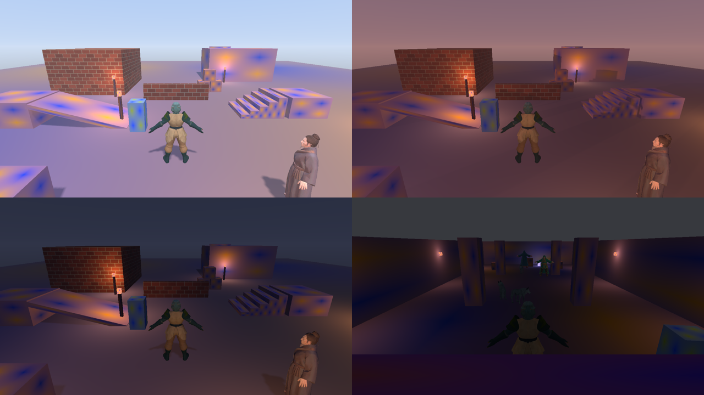
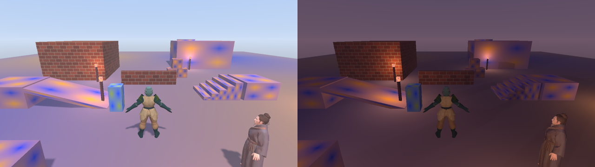

# S6 — Lighting & atmosphere: verification record

## Record

- Date: 2026-11-09
- Commit: `issue #UMBRA-82`, ADR 0010
- Tester: Claude (remote session), Linux cloud workspace (GCC 13, Clang 18, ASan/UBSan). The
  Vulkan renderer ran on SwiftShader (a CPU Vulkan driver) with the real DXC compiler. The browser
  build ran in Chrome on the same SwiftShader under a virtual display.
- User decisions (2026-11-09): the time of day is saved; a 12-minute day that starts at dusk in
  the settlement; nights moonlit and readable.
- State: **implemented; verified headlessly and in software-rendered pictures.** The frame time
  and the look on a real GPU are for the user on Windows (§4).

## What was built

| Part | Where |
|---|---|
| Light math, day/night table, light packing, shadow box | `engine/core/include/Lighting.hpp`, `src/Lighting.cpp`; explained in `Lighting.md` |
| `light` and `environment` components, `emissive` entity field | `engine/scene` (`EngineComponentSchemas`, `SceneFile.cpp`), `engine/world` (`World::SetLight`, `SetEnvironment`, `AdvanceTime`) |
| Vulkan: sky, shadow pass (2048² D16, PCF 3×3), lit scene, frame capture | `engine/render/shaders/Scene.hlsl`, `VulkanVertexPipeline`, `VulkanFrameResources`, `Renderer::CaptureNextFrame` |
| WebGPU: the same passes in WGSL, sRGB textures and canvas | `engine/render/web/umbra_render.js`, `RendererWeb.cpp` |
| Game: running clock, `--capture`, `--hour`, time kept across areas and in saves | `apps/umbra/Main.cpp`, `SceneRuntime.cpp`, `GameFlow.cpp`, `SaveGame` (`"hour"`) |
| Editor: color picker for color fields, Emissive field, range rings around a selected light | `apps/editor/Components.cpp`, `Editor.cpp` |
| Example | `settlement.scene.json`: `sky` (18:30, 12-minute day), 7 torches; `dungeon.scene.json`: `air` (indoors, cold tint), 6 wall torches, a glowing blue crystal |

## 1. Automated checks

| Check | Result |
|---|---|
| Linux GCC / Clang / GCC ASan+UBSan | **49/49 / 49/49 / 49/49** |
| T84 environment: sun high at noon, the moon (opposite, dim blue) at midnight, dusk colors between keys; indoors no sun, no shadows, tinted faint light; fog density from the setting | pass |
| T84 clock: advances by `24 / dayLength` per second, wraps at 24, stands still at day length 0 | pass |
| T84 packing: 20 lights → the 16 nearest kept (a big far light beats a small near one); flicker within 0.5..1; shadow texel size in `counts.y` | pass |
| T84 shadow box: centred on the target; moving less than a texel doesn't move it | pass |
| T84 scene: `light` and `environment` parse with defaults merged, reach the draw list at world positions, save back with the current hour; bad values refused with the field; a second environment warned about (`scene.environment.twice`); engine schemas listed and their names reserved for projects | pass |
| T84 saves: an hour round-trips; an out-of-range hour is dropped and the save still loads; old saves have none | pass |
| WGSL validated with naga-cli 30 (scene and UI shaders) | pass |

## 2. Pictures (software rendering)

Vulkan (`Umbra --capture … --hour 11 / 18.3 / 23`, and the dungeon):

Noon shows sun shadows under the hero and the elder. Dusk shows the torches' warm pools and the
glowing flames. Night is moonlit and blue but readable. The dungeon is lit only by torches and the
crystal.

Browser (WebGPU, `index.html?args=--hour%2011`, then the default dusk start):

The same picture as Vulkan, including shadow placement, which checks the flipped shadow lookup.

Known cloud-only problem: SwiftShader crashes while compiling the ImGui overlay's vertex shader
after the swapchain is recreated (inside `sw::SpirvEmitter::emit`, in SwiftShader's own code). Capture mode therefore hides the
overlay. Real GPUs are not affected (the overlay has run on the user's PC since P2).

## 3. Builds

| Build | Result |
|---|---|
| GCC Debug | 49/49 |
| Clang Debug | 49/49 |
| GCC ASan+UBSan | 49/49 |
| Plugin sets (turn-only + learned AI; real-time only) | 37/37, 33/33 |
| Web build (Emscripten) + `check-web.py` | built; **13/13**; pictures in §2 |

## 4. Windows checklist (user)

1. Build and start the game. The settlement starts at dusk (18:30): an orange horizon, torch
   flames that glow and flicker, warm light pools on the ground and walls.
2. Wait about 30 seconds: it becomes night. Moonlight is blue and the scene stays readable. After
   about 6 minutes it is dawn, then day with sharp sun shadows under the characters.
3. Save at the save stone at night, quit, continue: it is still night (the hour is in the save).
4. Walk into the dungeon: no sky, cold blue tint, torches on the walls and a glowing blue crystal.
   Walk back out: the settlement's clock carried on.
5. `Umbra.exe --hour 12` and `--hour 0`: noon and midnight pinned. `Umbra.exe --capture shot.png`
   writes a PNG of the 3D view and quits.
6. Frame time: the diagnostics window's frame time in the settlement at dusk (7 lights and shadows)
   should stay within the O18 budget. Note the number.
7. Editor: select a torch flame. Its light shows three colored range rings, and the Light component
   has a color picker, intensity, range and flicker. Change the range and see the rings change. Add an
   Environment component to a test scene and change Hour, Fog and Tint.
8. Browser (`scripts\serve-web.bat`): the same dusk look in Chrome or Edge, with shadows at
   `index.html?args=--hour%2012`.
