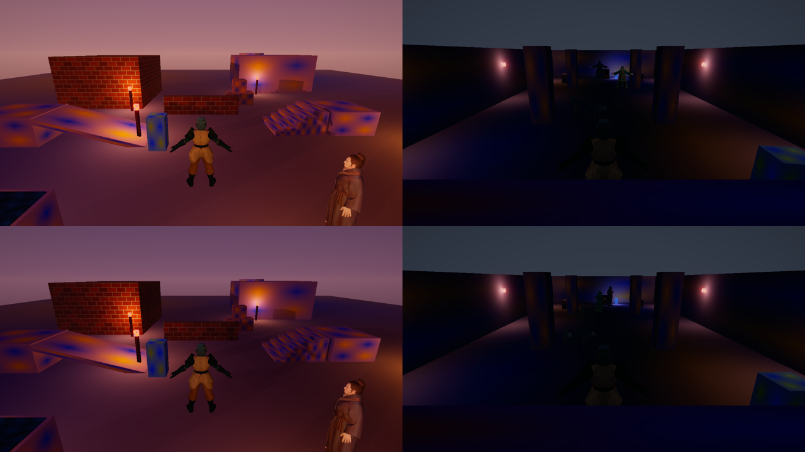

# S7 — Post-processing & custom shaders: verification record

## Record

- Date: 2026-11-09
- Commit: `issue #UMBRA-83`, ADR 0010
- Tester: Claude (remote session), Linux cloud workspace (GCC 13, Clang 18, ASan/UBSan). The
  Vulkan renderer ran on SwiftShader (CPU Vulkan) with the real DXC compiler. The browser build ran
  in Chrome on the same SwiftShader under a virtual display.
- User decisions (2026-11-09): custom shaders reach the browser by converting SPIR-V to WGSL at build
  time (naga); phones get reduced post (tonemap, grade and vignette on, bloom from a smaller picture).
- State: **verified** (the user's S6 + S7 review on Windows, 2026-11-09: "everything works fine"; the
  review found a crash on undo in the editor's Game UI window, tracked separately in the ROADMAP).

## What was built

| Part | Where |
|---|---|
| Post math: tonemap, grade baking into a 16³ table, LUT image check, vignette, quality levels | `engine/core/include/Post.hpp`, `src/Post.cpp`; explained in `Post.md` |
| `post` component (one per scene, optional LUT image) | `engine/scene` (`EngineComponentSchemas`, `SceneFile.cpp`), `engine/world` (`World::SetPost`) |
| Vulkan: HDR scene picture, 6-level bloom chain, composite before the overlay, 3D color table | `engine/render/shaders/Post.hlsl`, `src/VulkanPost.cpp`; `VulkanAllocator::CreateColorTarget`, `CreateLut3D` |
| Custom surface shaders: `Surface.hlsli`, the hook in `Scene.hlsl`, a pipeline per shader, material `shader` field | `engine/render/shaders/CustomShaders.md`, `SurfaceShaders.cmake`, `VulkanVertexPipeline::GetSurfacePipeline`, `assets::Material::shader` |
| Browser: HDR, bloom and composite in WGSL; surface shaders converted by DXC + naga and embedded | `engine/render/web/umbra_render.js`, `RendererWeb.cpp` |
| Packaging: all compiled shaders (also `surface/`, and S6's sky and shadow) installed and put in `game.pack` | `engine/render/CMakeLists.txt`, `engine/authoring/src/WebPack.cpp` |
| Example | settlement: warm evening `look`, `well_water` (rippling `water` shader); dungeon: cold `look` with `textures/lut_moonlight.png` and strong bloom, the crystal with the pulsing `crystal` shader |

## 1. Automated checks

| Check | Result |
|---|---|
| Linux GCC / Clang / GCC ASan+UBSan | **50/50 / 50/50 / 50/50** |
| T85 tonemap: middle gray stays ≈0.2, black stays black, brighter stays brighter, never past white | pass |
| T85 grade: neutral table changes nothing (within one 8-bit step); warm is redder; saturation 0 is gray; contrast 1.5 darkens darks and lightens lights | pass |
| T85 LUT image: an inverted 256×16 image turns white black; a 64×64 one is refused and ignored | pass |
| T85 pixel: exposure +1 and bloom brighten; vignette 1 leaves the middle and darkens a corner; Reduced quality starts smaller with fewer levels | pass |
| T85 scene: `post` read with defaults and its LUT image, extracted to the draw list, saved; wrong-sized LUT (`entity.post.lut`), missing LUT, out-of-range bloom refused; a second post warned about and ignored | pass |
| T86 material: `shader` kept and written back, `SurfaceName` = "water"; missing file and wrong name refused (`material.shader`) | pass |
| T86 `Umbra.Render.SurfaceShaderErrors`: a broken surface shader compiled by the real DXC is refused, and the error names `broken.surface.hlsl:5` | pass |
| WGSL validated with naga-cli 30: scene, post and UI shaders, and both converted surface shaders | pass |
| Vulkan validation layer (Khronos, built from source) with synchronization validation on SwiftShader: settlement and dungeon captures, plus 60 s of the game with its overlay | no errors; only two performance notes (the shadow pipeline doesn't read normals and UVs) |
| Browser: no WebGPU validation messages in the console while drawing (Chrome on SwiftShader) | pass |

## 2. Pictures (software rendering)

Top: Vulkan. Bottom: browser (WebGPU). Left: the settlement at dusk with the warm look; the
rippling well water is at the bottom left. Right: the dungeon with the cold look and bloom around
the torches and the crystal.

## 3. Builds

| Build | Result |
|---|---|
| GCC Debug | 50/50 |
| Clang Debug | 50/50 |
| GCC ASan+UBSan | 50/50 |
| Plugin sets (turn-only + learned AI; real-time only) | 38/38, 34/34 |
| Web build (Emscripten, with the two surface shaders converted) + `check-web.py` | built; **13/13** |

## 4. Windows checklist (user, together with S6)

1. Build with the Vulkan SDK. The build log shows "Compiling surface shader water.surface.hlsl" and
   "crystal.surface.hlsl".
2. Settlement at dusk: a warm, slightly punchy picture, a soft glow around the torch flames, darker
   corners. The well's top is rippling water that moves.
3. Dungeon: a cold blue-green look. The torches and the crystal glow (bloom), and the crystal pulses
   slowly, with shimmering edges as you walk around it.
4. Editor: select `look` in the settlement. Its Post-processing component has sliders. Set Bloom to 2
   and Temperature to -1, and the game (after saving) turns cold and glowy. Pick
   `textures/lut_moonlight.png` as the color table.
5. Break `water.surface.hlsl` on purpose (type `foo;` on a line) and build: the error names the file
   and line. Undo it.
6. Frame time in the settlement at dusk (lights, shadows, bloom) on the RTX 3050 laptop: note it next
   to the S6 number. It should stay within O18.
7. Browser (`scripts\serve-web.bat`, Chrome or Edge): the same looks, and the water moves.
