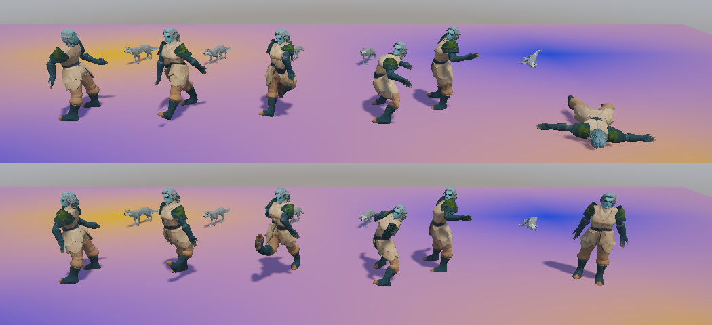
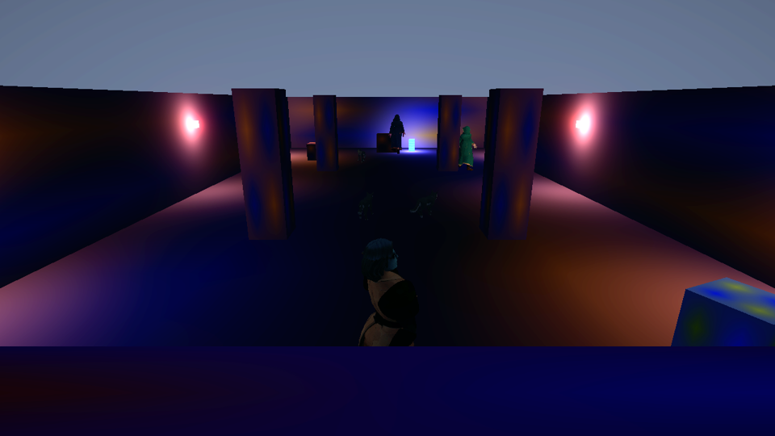

# S8 — Skeletal animation & rigging: verification record

## Record

- Date: 2026-11-10
- Commit: `issue #UMBRA-84`, ADR 0010
- Tester: Claude (remote session), Linux cloud workspace (GCC 13, Clang 18, ASan/UBSan). The
  Vulkan renderer ran on SwiftShader (CPU Vulkan); the browser build in Chrome on the same
  SwiftShader under a virtual display. No GPU: UniRig and HY-Motion were not run for real.
- User decisions (2026-11-10): the hero and bandit rigged and animated with Meshy; a free (CC0)
  animated wolf; AI rigging and text-to-motion through a local ComfyUI (UniRig, HY-Motion), tested
  with a stand-in server.
- State: **implemented**; the user's check on Windows (§4) is open.

## What was built

| Part | Where |
|---|---|
| Skeletons, clips, sampling (lerp/slerp/step, loop/hold), pose blending, palette, rest-pose positions | `engine/core/include/Skeleton.hpp`, `src/Skeleton.cpp`; explained in `Skeleton.md` |
| Animator: first matching state, flags, numbers, triggers, one-shots, crossfade, speed-driven rate | `engine/core/include/Animator.hpp`, `src/Animator.cpp` |
| glTF skins and clips imported (weights normalised), kept in the `.umodel` cache (format 2) | `engine/assets/src/GltfImporter.cpp`, `ModelCache.cpp`; `AssetPipeline.md` |
| Graph files `*.anim.json`, `animation` component, `BindAnimators` (a still animator for rigged models without one) | `engine/scene/include/AnimGraph.hpp`, `AnimGraph.md`; `SceneFormat.md` |
| World: animators per entity, `UpdateAnimation`, joint matrices in the draw list | `engine/world` (`World::SetAnimator`, `ExtractDrawList`), `core::DrawList::joints` |
| Vulkan: joint storage buffer per frame (16384 matrices), skinned scene, shadow and surface-shader pipelines | `engine/render/shaders/Scene.hlsl` (`VSSkinned`, `ShadowSkinnedVS`), `VulkanVertexPipeline.cpp`, `VulkanFrameResources.cpp` |
| Browser: the same in WGSL (`vsSkinned`, `shadowSkinnedVs`), skin buffers, joint storage buffer | `engine/render/web/umbra_render.js`, `RendererWeb.cpp`; `WebRenderer.md` |
| Game: speed/attack/hit/dead drive the hero, enemies and wolves; a defeated enemy falls before it goes; no procedural bob on a rigged player; graph files hot-reload | `apps/umbra/SceneRuntime.cpp`, `GameFlow.cpp` |
| Editor: rigged models play idle in the view and are measured at rest; actor form has an Animation field; AI animation window | `apps/editor/Editor.cpp`, `plugins/rpg/editor/RpgForms.cpp`, `plugins/ai-authoring/editor/AiAnimation.cpp` |
| AI rig / motion through the creator's exported ComfyUI workflows, FBX via Blender, `UmbraTool rig` / `motion` | `plugins/ai-authoring/modules/localai` (`ComfyUi.cpp`, `AnimationGen.cpp`, `AnimationGen.md`), `tool/AiCommands.cpp` |
| Packing tool for rigged characters | `tools/models/pack_animated.py`, `tools/models/README.md` |
| Example | the hero, bandits (Meshy rigs + six clips) and wolves (Quaternius CC0) in the settlement, dungeon and arena; `animations/humanoid.anim.json`, `wolf.anim.json` |

## 1. Automated checks

| Check | Result |
|---|---|
| Linux GCC / Clang / GCC ASan+UBSan | **52/52 / 52/52 / 52/52** |
| T87 clips: 45° halfway, loops back, holds the end, step keys hold, joints a clip doesn't move stay at rest, unknown joints skipped | pass |
| T87 palette: rest leaves vertices in place; a 90° root turn swings a point 2 m up the arm to x = −2; blending halfway gives 45° | pass |
| T87 animator: idle → walk with the speed (rate 2 = time ×2) → attack plays to its end → walk again → dead wins over a waiting trigger; a missing clip is reported | pass |
| T87 importer: hero.glb has 24 joints, clips idle/walk/run/attack/hit/death, weights summing to 1, a rest-pose height of −1..1, all kept through the `.umodel` cache | pass |
| T87 graphs: the two reference graphs load; every mistake named (`animgraph.format/states/fade/state/when/rate/event/read`) | pass |
| T87 binding: the player plays idle then walk; a rigged statue without a graph holds its rest pose; an unrigged model and a missing graph are reported; the draw list carries both palettes | pass |
| T88 workflows: rig and motion stand-ins accepted, each refused as the other kind, UI format refused | pass |
| T88 run: the model uploaded into the loader's `3d` folder and named there; text, length, seed and character filled in; a GLB result preferred over an FBX; a path on disk (`C:\ComfyUI\output\rigged\...`) understood; results saved with `.source.json`; a result without a skeleton not kept | pass |
| T88 FBX without Blender: `ai.convert`, naming `UMBRA_BLENDER` | pass |
| `UmbraTool motion` with a non-local host (`ai.host`); `UmbraTool rig` without a workflow (says how to export one) | pass |
| The browser's scene WGSL with the skinning entry points validated by naga-cli | pass |
| Vulkan validation layer (Khronos, built from source, synchronization validation) on SwiftShader: 60 frames of the dungeon with the rigged hero, bandits and wolves | no errors; only performance notes (the plain and skinned shadow pipelines don't read normals and UVs) |

## 2. Pictures (software rendering)

Every clip at once: a test scene (not kept) with one hero and one wolf per clip, each playing a
one-state graph (idle, walk, run, attack, hit, death from left to right). Top: Vulkan. Bottom:
browser (WebGPU), a moment later in each clip.

The dungeon at noon: the rigged hero from behind, bandits standing on the floor, wolves walking.

Facing was checked from the rest-pose geometry: the hero's and bandits' feet point to −Z (Umbra's
front) with `--turn 0`; the wolf's head was at +Z and needed `--turn 180`.

## 3. Builds

| Build | Result |
|---|---|
| GCC Debug | 52/52 |
| Clang Debug | 52/52 |
| GCC ASan+UBSan | 52/52 |
| Plugin sets (real-time only; turn-only + learned AI) | 34/34, 38/38 |
| Web build (Emscripten) + `check-web.py` | built; **13/13** |

## 4. Windows checklist (user)

1. Build and run the game. In the settlement the hero breathes (idle); walking plays the walk and,
   faster, the run; the feet don't slide much. No bob/lean wobble on top.
2. Dungeon: wolves and bandits walk toward you with their own walk/run. Start a fight: the attacker
   swings, the one hit flinches and flashes red, a defeated enemy falls and disappears after about
   2.5 s; if you lose, the hero falls.
3. Editor: the hero in the settlement plays idle in the view. In RPG content, an actor's Look shows
   an Animation field. Change `animations/humanoid.anim.json` (e.g. `fade` 1) while the game runs:
   the characters pick it up.
4. Browser (`scripts\serve-web.bat`, Chrome or Edge): the same animations.
5. AI animation window, with ComfyUI running:
   - install ComfyUI-UniRig, build a rigging workflow (load mesh → skeleton → skinning → save), Export
     (API) it as `projects/reference/tools/comfyui/rig.api.json`; rig `models/elder.glb`. A result in FBX
     needs Blender installed (or `UMBRA_BLENDER` set to `blender.exe`). Note what file type the save
     node wrote and whether Umbra found it.
   - install ComfyUI-HY-Motion1 and its weights, export a motion workflow as `motion.api.json`;
     make "waves hello" for 3 s with `models/hero.glb` as the character. Note whether the clip plays
     on the hero (in a graph: `"clip": "animations/waves_hello.glb#<clip>"`).
6. Frame time in the dungeon with all the animated characters on the RTX 3050 laptop: note it next
   to the S7 number (O18).
