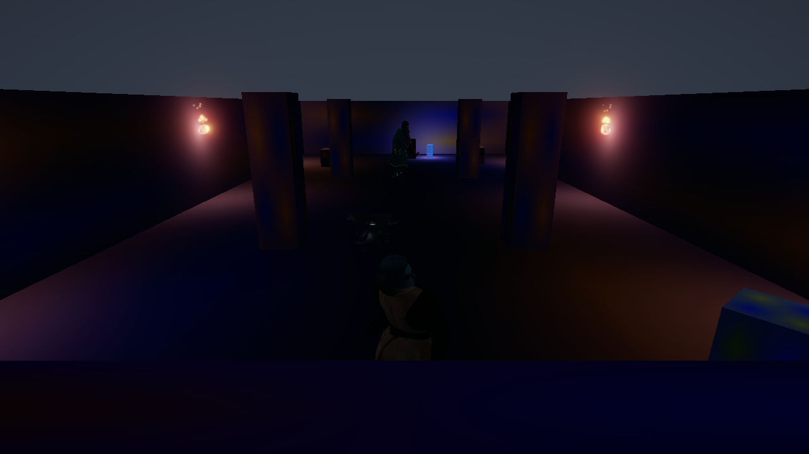
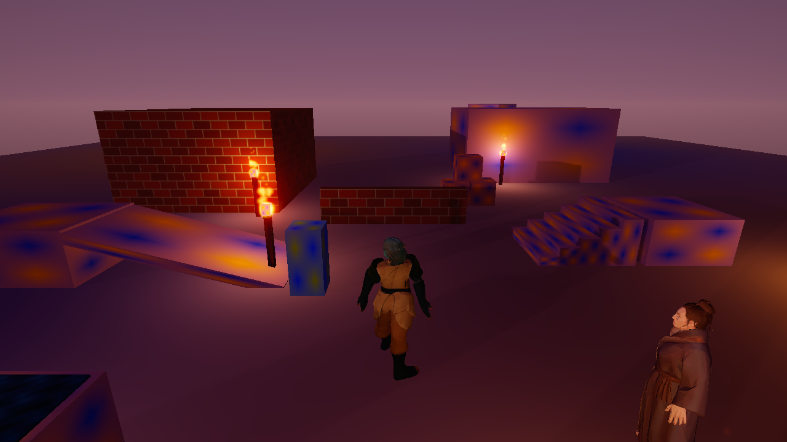
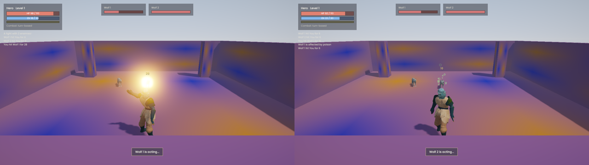

# S9 — Animation events, SFX & VFX: verification record

## Record

- Date: 2026-11-10
- Commit: `issue #UMBRA-86`, ADR 0010
- Tester: Claude (remote session), Linux cloud workspace (GCC 13, Clang 18, ASan/UBSan). The
  Vulkan renderer ran on SwiftShader (CPU Vulkan); the browser build in Chrome on the same
  SwiftShader under a virtual display. No GPU and no sound card: timing was checked by tests and
  pictures, sounds were not listened to.
- State: **implemented**; the user's check on Windows (§4) is open.

## What was built

| Part | Where |
|---|---|
| Clip events with optional `sound` and `effect`, fired once per crossing (slow frames, loops) | `engine/core/include/Animator.hpp`, `src/Animator.cpp`; `engine/scene/include/AnimGraph.md` "Events" |
| Particle simulation: effects, emitters, a system with one-shots and attached emitters, repeatable per seed | `engine/core/include/Particles.hpp`, `src/Particles.cpp`; explained in `Particles.md` |
| Effect files `vfx/*.vfx.json`, the `vfx` component, `SyncVfx` | `engine/scene/include/Vfx.hpp`, `src/Vfx.cpp`; `SceneFormat.md`, `Components.md` |
| Vulkan: instanced camera-facing squares, premultiplied blending, last in the HDR scene pass | `engine/render/shaders/Particles.hlsl`, `VulkanVertexPipeline.cpp`, `VulkanFrameResources.cpp` |
| Browser: the same in WGSL | `engine/render/web/umbra_render.js`, `RendererWeb.cpp`; `WebRenderer.md` |
| Game: clip events play sounds (quieter with distance) and effects; blows land on the attacker's `hit` event; statuses, skills and items show their effects | `apps/umbra/SceneRuntime.cpp`, `GameFlow.cpp`; `GameFlow.md` "Blows" |
| Game feel: damage numbers, hit-stop, camera shake, red flash | `apps/umbra/GameFeel.hpp/.cpp`, `GameFeel.md` |
| RPG content: `effect` on skills, items and statuses (looks only), checked by validation | `plugins/rpg/modules/rpg`, `engine/authoring/src/Validate.cpp`; `Rpg.md` |
| Editor: effects run in the view; **Effects** asset list; Effect field in the RPG forms | `apps/editor/Editor.cpp`, `plugins/rpg/editor/RpgForms.cpp` |
| `--demo <skill>`: a turn fight that plays itself, for pictures and checks | `apps/umbra/Main.cpp`, `GameFlow::Demo` |
| Example | fire on the 13 torches of the settlement and dungeon; step dust and footstep sounds, a swing sound and a `hit` moment in the hero's, bandit's and wolf's graphs; a new **fireball** skill; poison bubbles (venom strike, poison status); a green glow on the health potion; six effects in `vfx/` |

## 1. Automated checks

| Check | Result |
|---|---|
| Linux GCC / Clang / GCC ASan+UBSan | **52/52 / 52/52 / 52/52** |
| T89 events: a one-shot at 60 and at 5 frames a second gives start, swing, hit once each, in order; one 2 s frame gives all three with their sound and effect; taken once | pass |
| T89 events, looping: two steps a lap at 60, 10 and 2 frames a second (6 in 3 s); a 60 s stall gives at most four laps | pass |
| T89 particles: the same seed and steps give byte-identical instances, another seed differs; 5 burst + 40/s for 0.5 s = 25; the instance is 48 bytes | pass |
| T89 particles: never above `max`; size and alpha inside the birth/death values; a stopped emitter finishes and is done | pass |
| T89 system: a one-shot ends by itself, an attached emitter keeps burning and is not doubled by attaching again, far particles come first, detached ones fade out | pass |
| T89 effect files: the six shipped effects load; every mistake named (`vfx.format/rate/lifetime/velocity/color/blend/max/ring/read`) | pass |
| T89 `vfx` component: read, saved back, one emitter at the entity however often it is synced, gone when the component is removed; an empty effect is `entity.vfx.effect` | pass |
| T89 graphs: the three shipped graphs have four `step` events (with footstep sound and dust) and one `hit` | pass |
| T89 validation: the shipped RPG content and settlement pass with their effects; a potion or a torch naming a missing effect file fails with `vfx.read` | pass |
| The browser's scene WGSL with the particle entry points validated by naga-cli | pass |
| Vulkan validation layer (Khronos, synchronization validation) on SwiftShader: a self-playing fireball fight from the dungeon | no errors |

A slow first frame used to lose a trigger set just before it (the trigger's half second ran out
before the state was chosen); triggers now age after the choice. Found by the T89 slow-frame case.

The browser's particle pipeline first named the wrong depth format (`depth32float`; the scene pass
uses `depth24plus`), which Chrome reported as a validation error. Fixed; found by the browser run,
not by naga (which checks shader text only).

## 2. Pictures (software rendering)

Torch fire in the dungeon (Vulkan) and in the settlement (browser, WebGPU):

A self-playing fight (`--demo fireball`, `--demo venom_strike`). Left: the fireball lands on a
wolf with a gold "28" (a heavy blow). Right: poison bubbles stay over the poisoned wolf.

## 3. Builds

| Build | Result |
|---|---|
| GCC Debug | 52/52 |
| Clang Debug | 52/52 |
| GCC ASan+UBSan | 52/52 |
| Plugin sets (real-time only; turn-only + learned AI) | 34/34, 38/38 |
| Web build (Emscripten) + `check-web.py` | built; **13/13** |

## 4. Windows checklist (user)

1. Build and start the game. In the settlement the torches burn (small flames rising from each).
2. Walk and run: a footstep sound and a small puff of dust on each step, in time with the feet.
3. Start a fight (turn-based). **Attack**: the swing is heard as the arm moves; the hit sound, the
   sparks, the white flash and the number appear when the blow lands, not when you press the key.
4. Open the skill tree, unlock **Fireball** (needs Strike, 1 point) and use it: a bright burst on
   the target and a gold number if it takes a quarter of its health; a short freeze and shake.
5. Unlock **Venom strike** and use it: green bubbles stay over the poisoned enemy until it ends.
6. Get hit: the screen flashes red briefly. Drink a health potion: a green glow and a green `+n`.
7. Press **Tab** for real-time combat and fight a bandit: the same sounds, sparks and numbers.
8. Editor: open the dungeon; the torches burn in the view. Select a torch flame: its `vfx`
   component shows the effect. Add a `vfx` component to another entity and pick `vfx/poison.vfx.json`.
9. Edit `vfx/fire.vfx.json` while the game runs (for example `"rate": 120`) and save: the fire
   changes without a restart.
10. Browser build (Chrome or Edge): torches burn, a fight shows sparks and numbers.

Not checked in the cloud: how it sounds, how it feels at a real frame rate (hit-stop and shake
lengths are easy to change at the top of `apps/umbra/GameFeel.cpp`), and the editor view.
